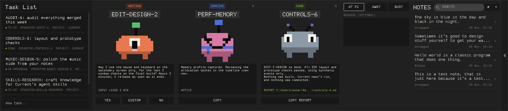
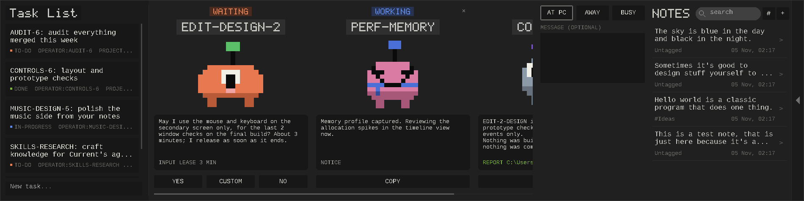
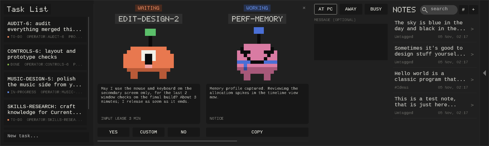
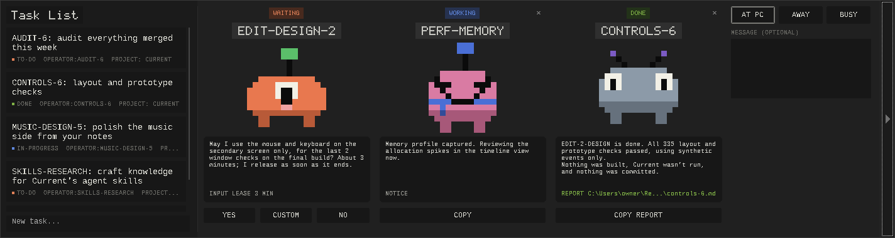

# Knock

A little tray app I made because I work with agents a lot, and sometimes they
need the same mouse and keyboard I'm using.

They ask here, I answer, and they can get on with it. It also catches the output
from long builds and tells me when they're done, so an agent doesn't have to
keep checking a terminal.

There's a task list and a place for personal notes too. The notes are basically
conversations with yourself: text, links, screenshots, and whatever else you
want to keep together.

This started as a side tool for my own projects. Putting it here because why
not. I'll keep changing it as I use it.

## Download

[Download for Windows (x64)](https://github.com/qwoicpp/Knock/releases/latest)

The ZIP includes the ready-built app and CLI. Extract the whole thing and run
**KnockTray.exe**.

## What it looks like



<details>
<summary>At 125% and 150% scaling, and with the notes tucked away</summary>







</details>

These are captures of the Windows build running under Wine, using sample
records. Your own install starts empty.

## Using it

Extract the whole Windows x64 zip into a folder you want to keep, then run
**KnockTray.exe**. Keep **knock.exe** and the **assets** folder beside it.
There's no extra application runtime to install.

Click the tray icon or press **Ctrl + Alt + K** to open or hide it. It's a wide
bar along the top of the screen, centred:

- **Task List** on the left. Click a task to edit it; type in **New task...**
  and press **Enter** to add one.
- **Job cards** in the middle, one per chat label. Each has a status tag
  (**WAITING**, **WORKING** or **DONE**), the job's name, its own little pixel
  character, and what it's asking or reporting. A request has **YES**,
  **CUSTOM** and **NO** under it; a finished job has **COPY REPORT**. Scroll
  sideways when there are more cards than fit. **×** clears a card.
- **Your status** (At PC, Away, Busy) with an optional message.
- **Notes** with a search box. The arrow on the far right tucks the notes away
  and brings them back; Knock remembers which you chose.

Opening from the tray gives you a bar that hides when you click away. Opening
with the shortcut keeps it open and on top while you use other windows. Press
the shortcut again or choose **Hide Knock** from the right-click menu when
you're done. **Escape** backs out of the current view, then hides the bar.

Right-click anywhere in the bar and choose **Settings** to make it yours:

- **CHANGE** lets you record a different hotkey or disable it.
- Set the bar's width and height, then **APPLY**. The range is 900–3840 wide
  and 300–800 tall, in logical pixels; **RESET** returns to 1720 × 380. It
  always fits inside the screen, so at 150% scaling it may be narrower.
- Turn on **Start with Windows** if you want it there when you log in.

You can also open Settings or quit Knock from the tray menu.

**Settings → More** has saved replies, a quiet timer, and how long deleted notes
stay in Trash. Right-click anywhere and choose **Quiet notifications...** to quiet banners
for 15 minutes, 30 minutes, or an hour. Requests still wait in the inbox and keep
their normal expiry. When the timer ends, Knock sends one inbox summary.

Cards waiting for an answer come first, then working ones, then finished ones.
**CUSTOM** turns the card's text box into a reply box; **SAVED** puts a preset
into it, edit it if needed, then press **SEND**. Manage your own presets in
Settings → More. The characters are drawn by Knock from the job's name, so the
same job always gets the same one.

To update, quit the running copy and replace its application files. Saved data
lives separately, so your notes and tasks stay put.

### Stepping away

Use the status column: click **At PC**, **Away**, or **Busy**. The message
box under it is optional; it's saved with the status when you click one, when
you press **Enter**, or a moment after you stop typing. Something like “Out
for coffee” or “In a meeting; headless tests are fine” is enough. **Status...**
in the right-click or tray menu jumps to the message box. Until you pick one,
agents see no status.

Agents get the status with their requests. While Away or Busy, a normal request
that's still pending stays in the inbox but returns immediately with the status
and message, so the agent can do other work. A pending request already waiting
does the same when the status changes to Away or Busy. An answer or expiry takes
precedence. Returning to At PC doesn't answer any requests
or restart a chat; the usual Yes/No/Custom buttons still decide what happens.

This is a manual setting. It survives restarting Knock and stays as set until
you change it. It doesn't guess from mouse activity. The quiet timer is
separate: it only silences notification banners.

### Notes

Type in the notes **search** box to narrow the list by title, description or
tag, and click a note to open it in the middle of the bar. **Enter** opens the
best match, or makes a new note with that title when nothing matches; **+**
makes one straight away. A name like “Websites” or “Project ideas” is enough.

- **Enter** sends a message; **Shift + Enter** starts a new line.
- **Ctrl + V** pastes text or an image into the composer. Images appear as
  attachments before you send them.
- Scroll back through the conversation whenever you need it.
- Right-click an entry to **Edit entry**. **Up Arrow** in an empty composer
  edits your latest entry. Save or cancel the edit; your unfinished new message
  is kept separately, including its pasted images.
- **Ctrl+F** searches the conversation. Previous/next finds matching entries,
  including older messages that were not loaded when you opened the note.
- **TAGS** organizes the note, and **EDIT** changes its title and description.
  **#** next to the search box narrows the list to a tag or untagged notes.

It's your own notebook. Nothing in a note gets executed or sent to an AI.
Existing notes from earlier versions keep their text as the first message.

For finding and clearing things out, the notes search box also takes a couple
of commands:

- **`/find-note`** opens a search page. Add a name, like
  **`/find-note websites`**, or just type on that page to narrow the results.
  Exact titles come first, then titles that start with or contain what you
  typed. Click a result or select it with the arrow keys and press **Enter**.
- **`/delete-note`** opens a separate list for deleting notes. You can add a
  search after this command too. Clicking a **DELETE** row moves that note to Trash;
  **Back** takes you out of the list.
- **`/search-notes words`** searches the text inside your conversations. Results
  show a matching excerpt; opening one takes you straight to that entry.
- **`/trash`** lets you restore deleted notes or delete them permanently.
  A quick **UNDO** also appears just after deleting a note. Trash keeps notes
  for 30 days by default; Settings → More lets you choose 1–365 days.

Deleted notes keep their messages, tags, and attachment references in Trash.
Reducing the retention period removes entries older than the new limit when
you apply it. Imported image files are retained on disk; attachment cleanup
isn't implemented yet.

Type **`/`** to see the available commands as you type. Use the arrow keys and
**Enter**, or click a suggestion. An unknown slash command won't create a note.
These commands belong to the Notes list; text inside a note stays your text.

### Agents

Give your agents the path to `knock.exe` and tell them to run:

```powershell
.\knock.exe info
```

That returns the usage guide, including how to wait without repeated model
polling, reuse IDs, and keep tool output small. It works without opening the
tray or reading your saved data. `get-info` is an alias. The same guide is in
[AGENT_INSTRUCTIONS.md](docs/AGENT_INSTRUCTIONS.md), beside the executables in
the portable package.

A request looks like this, from PowerShell in the Knock folder:

```powershell
.\knock.exe request --chat AUDIO-1 --message "Can I use the mouse and keyboard for about three minutes?" --lease 300
```

The chat label tells you who's asking. You can answer **Yes**, **No**, or write
your own reply. The command waits for that answer without model polling, unless
the status is Away or Busy. Agents can also read the status with
`knock.exe presence`. They release the input lease with
`knock.exe release REQUEST_ID` when they're done.

For a build you want to leave running:

```powershell
.\knock.exe run --chat AUDIO-1 --title "Release build" --cwd "C:\Projects\Current" -- cmake.exe --build build --config Release
```

Knock captures the result and sends a notification when it finishes. Use
**COPY** on the job's card and paste the message back into the named chat
to wake the agent up. Resuming a chat automatically would need support from
that agent's host.

When an agent has finished the whole job, it tells you:

```powershell
.\knock.exe done --chat AUDIO-1 --summary "Mixer done; all 40 tests pass. Nothing committed." --report "C:\Projects\Current\report.md"
```

Its card turns to **DONE** with the summary, and a task for that chat (operator
`AUDIO-1`, or a title starting `AUDIO-1:`) is ticked off. **COPY REPORT** puts
the summary and the report path on the clipboard as plain text.
`.\knock.exe inbox` lists finished jobs as JSON for other tools.

This is a cooperative permission system: agents have to follow the answer.
It doesn't lock input at the OS level. A custom reply, timeout, or error never
counts as permission to use the mouse.

## A few details

Native C++20 / Win32, a local named pipe, and files under
`%LOCALAPPDATA%\Knock`. That folder holds notes, pasted images, drafts, tasks,
request history, settings, and command logs. There are no accounts or cloud
services to set up. The CLI and tray app run in the same Windows session.

The job characters are generated by Knock itself from each job's name; no
image files are involved. The original character GIFs are still bundled but
no longer shown. Credits and dependency notices are in
[THIRD_PARTY_NOTICES.md](THIRD_PARTY_NOTICES.md).

Windows decides whether to show notification banners. These
[Shell_NotifyIcon notifications](https://learn.microsoft.com/en-us/windows/win32/api/shellapi/nf-shellapi-shell_notifyiconw)
are transient on Windows 11; Knock's inbox keeps the actual requests and
results.

## Building it

CMake 3.20+ and a C++20 compiler. The JSON headers are included, so the build
doesn't download dependencies. In a Visual Studio developer terminal:

```powershell
cmake -S . -B build -A x64
cmake --build build --config Release --parallel
ctest --test-dir build -C Release --output-on-failure
cmake --install build --config Release --prefix out/Knock
```

Close other copies of Knock before running the Windows integration tests.
The source also includes a MinGW cross-build toolchain and Linux core tests;
see [HANDOFF.md](HANDOFF.md) and [VALIDATION.md](docs/VALIDATION.md).

The executables and UI have been exercised under Wine on Linux. Actual Windows
11 notification, taskbar, Start-menu/focus, display-scaling, and multi-monitor
behavior still need desktop checks. The validation notes say exactly what was
tested.

More detail: [CLI reference](docs/CLI.md) · [local protocol](docs/PROTOCOL.md) ·
[feature tracker](docs/FEATURES.md).
